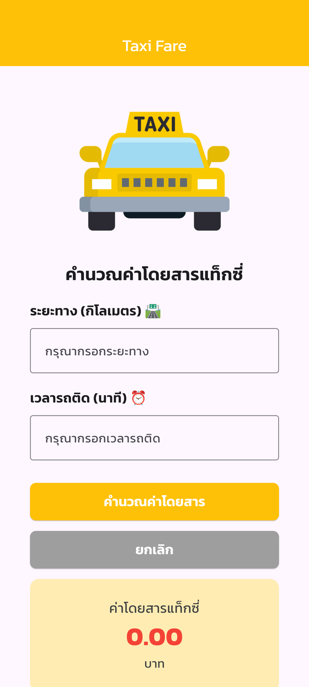
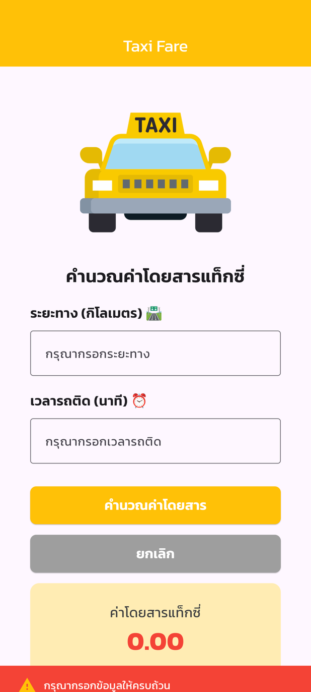
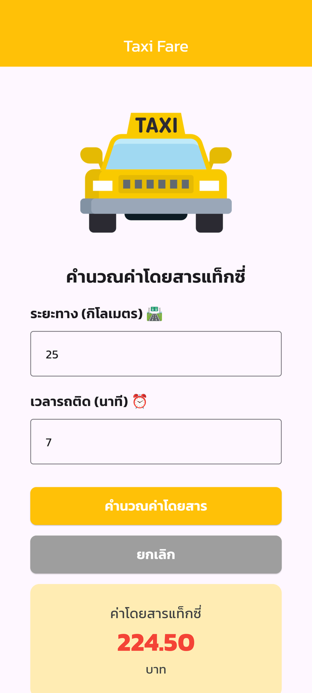

# 05-flutter_taxi_fare_app

**Taxi Fare** — a Thai taxi-meter fare calculator built from the Figma mockup
"Project: flutter_taxi_fare_app" (tested at Samsung Galaxy S20 Ultra size, 412 x 915).
Main font: Kanit (google_fonts).

## Screenshots

Captured from the running app at Samsung Galaxy S20 Ultra size (412 x 915).

<table>
  <tr>
    <td align="center"><br><b>SplashScreenUi</b><br>หน้าแรก</td>
    <td align="center"><br><b>TaxiFareUi</b><br>ยังไม่กรอกข้อมูล</td>
  </tr>
  <tr>
    <td align="center"><br><b>กดคำนวณโดยไม่กรอก</b><br>แถบแจ้งเตือนสีแดง</td>
    <td align="center"><br><b>25 กม. + รถติด 7 นาที</b><br>= 224.50 บาท</td>
  </tr>
</table>

## Screens

| File | Class | Screen |
| --- | --- | --- |
| `lib/views/splash_screen_ui.dart` | `SplashScreenUi` | First page with a loading spinner, goes to TaxiFareUi after 3 seconds |
| `lib/views/taxi_fare_ui.dart` | `TaxiFareUi` | Distance + traffic minutes → fare in baht; red warning bar when a field is empty |

The fare formula is in `lib/utils/taxi_fare_calculator.dart`.

## Fare rates

| Distance | Rate |
| --- | --- |
| First km | 35 baht |
| km 2–10 | 6.50 baht/km |
| km 10–20 | 7.00 baht/km |
| km 20–40 | 8.00 baht/km |
| km 40–60 | 8.50 baht/km |
| km 60–80 | 9.00 baht/km |
| Over 80 km | 10.50 baht/km |
| Traffic jam | 3.00 baht/minute |

Each band is charged on its own, e.g. 25 km + 7 min = 35 + 9 × 6.50 + 10 × 7.00 + 5 × 8.00 + 7 × 3.00 = **224.50 baht**.

## Credits

Taxi icon: [Taxi icon by Magnific - Flaticon](https://www.flaticon.com/free-icon/taxi_619006) (free license with attribution).

## Run

```sh
flutter pub get
flutter run -d chrome
```

## Quality checks

```sh
flutter analyze
flutter test
```
